# ExpenseTracker — DevOps Final Capstone Submission

**Student:** Rishi Harti
**Repository:** https://github.com/rishi-harti768/expense-tracker-devops
**Application:** ExpenseTracker, a personal expense tracker (FastAPI, React, PostgreSQL)

This file maps each module in `GRADING.md` to its evidence. Each module section lists the code, the verification steps, and the screenshots.

| Module | Topic                  | Evidence                                                   |
| ------ | ---------------------- | ---------------------------------------------------------- |
| M1     | Application            | [Section M1](#m1--application-frontend--backend--database) |
| M2     | Testing                | [Section M2](#m2--testing-pytest)                          |
| M3     | Git and GitHub         | [Section M3](#m3--git-and-github)                          |
| M4     | Docker                 | [Section M4](#m4--docker)                                  |
| M5     | CI/CD                  | [Section M5](#m5--cicd-github-actions)                     |
| M6     | DevSecOps (Trivy)      | [Section M6](#m6--devsecops-trivy)                         |
| M7     | Terraform (AWS)        | [Section M7](#m7--terraform-aws-vpc-and-eks)               |
| M8     | Kubernetes and Helm    | [Section M8](#m8--kubernetes-and-helm)                     |
| M9     | Observability          | [Section M9](#m9--observability-prometheus-and-grafana)    |
| M10    | Documentation and demo | [Section M10](#m10--documentation-and-live-demo)           |

---

## M1 — Application (Frontend + Backend + Database)

**Endpoints** (`backend/app/main.py`, prefix `/api/expenses`):

| Method | Path                  | Purpose                           |
| ------ | --------------------- | --------------------------------- |
| GET    | `/health`             | Liveness check                    |
| GET    | `/ready`              | Readiness check (database access) |
| GET    | `/metrics`            | Prometheus metrics                |
| GET    | `/api/expenses`       | List expenses, newest first       |
| GET    | `/api/expenses/stats` | Totals by category                |
| GET    | `/api/expenses/{id}`  | Read one expense                  |
| POST   | `/api/expenses`       | Create an expense                 |
| PUT    | `/api/expenses/{id}`  | Update an expense                 |
| DELETE | `/api/expenses/{id}`  | Delete an expense                 |

**Database:** Table `expenses`, managed by Alembic. Migration: `backend/alembic/versions/0001_create_expenses.py`.

**Frontend:** React dashboard in `frontend/src/main.jsx`. It shows KPI cards, a category filter, a table with category cycling and delete, a create modal, and the three newest expenses.

**Files:** `backend/app/`, `backend/alembic/versions/`, `backend/requirements.txt`, `frontend/`, `docker-compose.yml`.

**Screenshot: application in the browser**

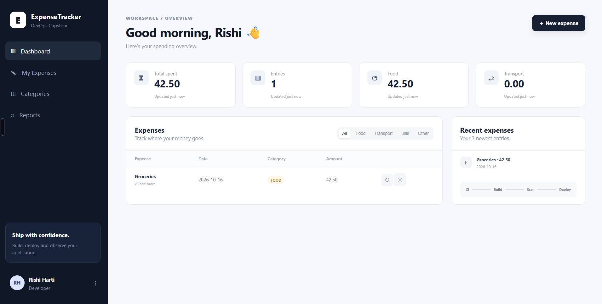

---

## M2 — Testing (Pytest)

**Tests:** `backend/tests/test_api.py` has 7 tests. They cover `/health`, `/`, POST, zero-amount validation (422), GET of a missing id (404), PUT and DELETE, and stats.

**Configuration:** `backend/pytest.ini`.

**Test database:** SQLite `test.db`, set through `DATABASE_URL`. The tests never use the PostgreSQL database.

**Screenshot: `pytest -v` output**

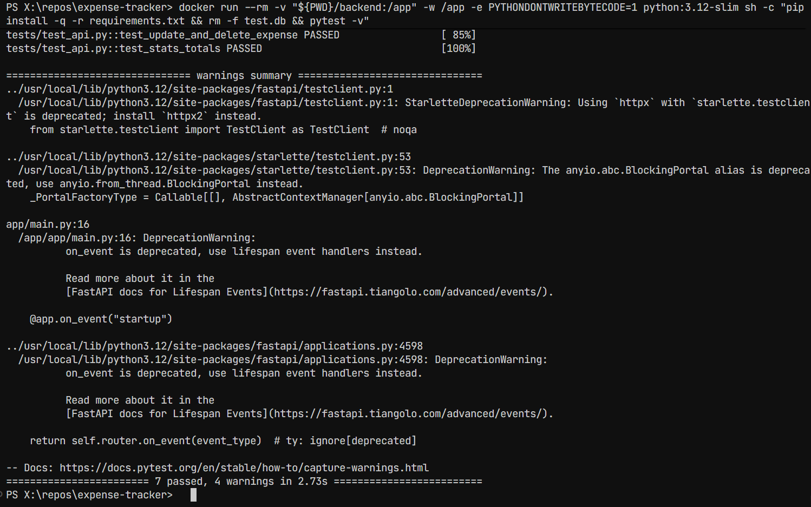

---

## M3 — Git and GitHub

**Repository:** https://github.com/rishi-harti768/expense-tracker-devops

**`.gitignore`** excludes `.env`, `__pycache__/`, `node_modules/`, `.venv/`, `*.db`, and Terraform state.

**Screenshots:**

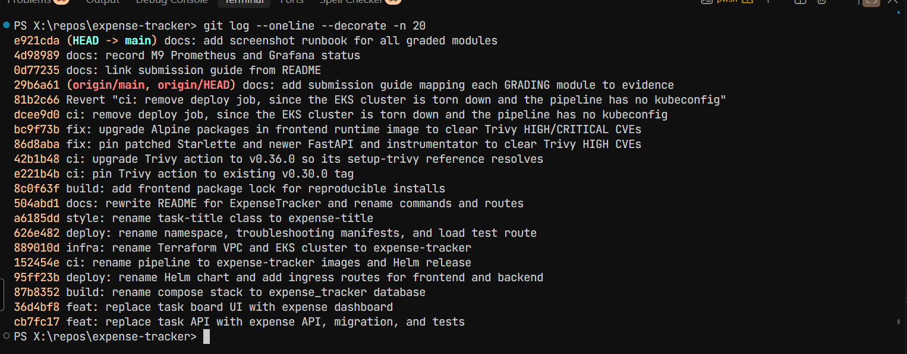
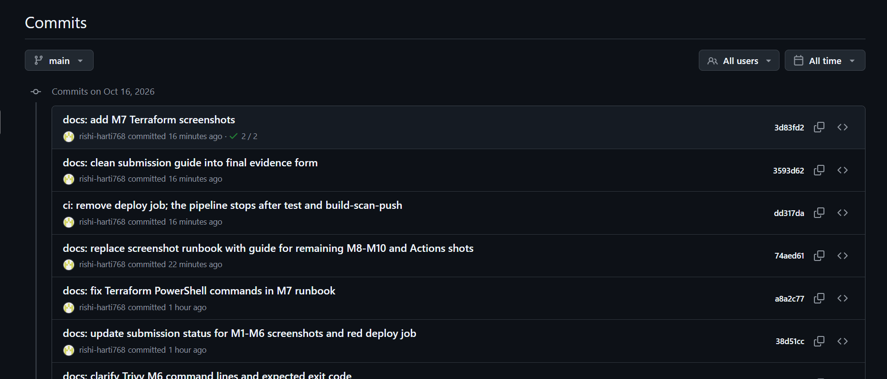

---

## M4 — Docker

| Item           | File                  | Result                                                        |
| -------------- | --------------------- | ------------------------------------------------------------- |
| Backend image  | `backend/Dockerfile`  | Builds. Runs as UID 10001.                                    |
| Frontend image | `frontend/Dockerfile` | Multi-stage: Node build, then nginx runtime. Runs as UID 101. |
| Compose        | `docker-compose.yml`  | Three services: `postgres`, `backend`, `frontend`             |

`docker compose up --build` starts all three services. The backend runs the Alembic migration before Uvicorn starts.

**Screenshots:**

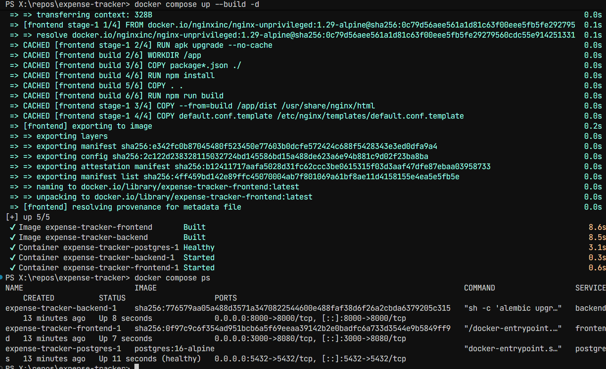

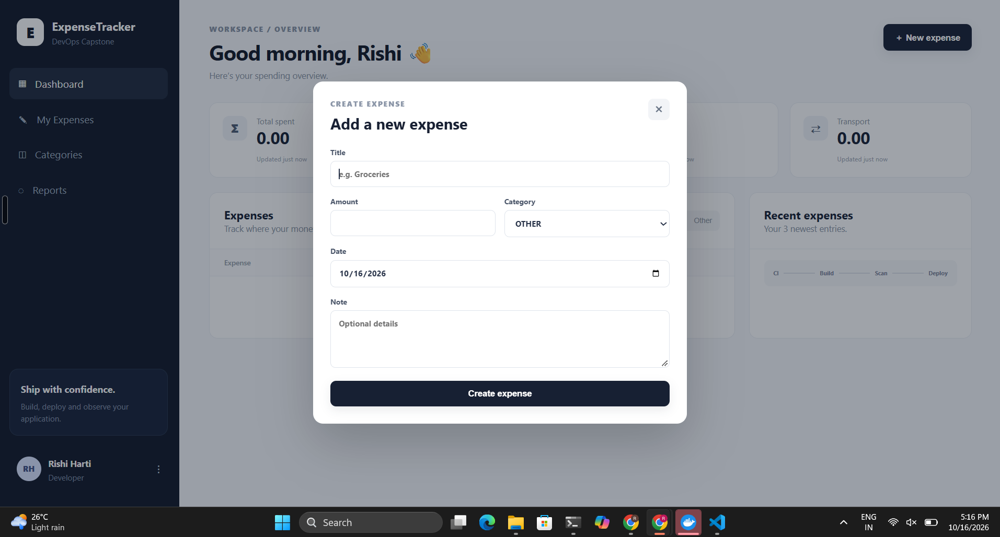

---

## M5 — CI/CD (GitHub Actions)

**Workflow:** `.github/workflows/ci-cd.yml`. It runs on every push to `main`.

| Job               | What it does                                                                                                       |
| ----------------- | ------------------------------------------------------------------------------------------------------------------ |
| `test`            | Installs the backend requirements, runs `pytest`, and builds the frontend.                                         |
| `build-scan-push` | Builds both images, scans them with Trivy, and pushes them to GHCR. Tags use the commit SHA (`${{ github.sha }}`). |

The pipeline ends after `build-scan-push`. Deployment to the cluster is manual, with Helm. See M10.

**Screenshots:**

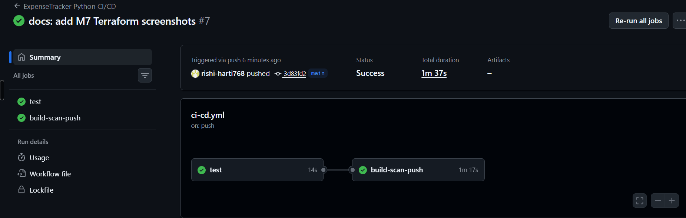
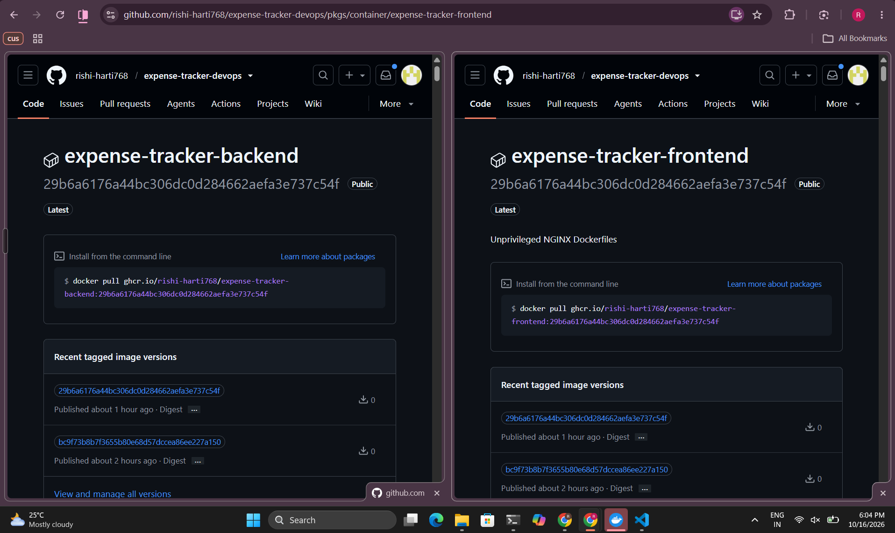

---

## M6 — DevSecOps (Trivy)

**Scan:** Trivy scans both images in `build-scan-push`. It uses `severity: HIGH,CRITICAL`, `ignore-unfixed: true`, and `exit-code: '1'`. A HIGH or CRITICAL finding fails the build, so the image is not pushed.

**Fixes made during the build:**

- Backend: Starlette CVEs fixed by pinning `starlette==1.3.1`, `fastapi==0.136.0`, and `prometheus-fastapi-instrumentator==8.1.0`.
- Frontend: OpenSSL and c-ares CVEs in the Alpine base. Fixed by moving to `nginx-unprivileged:1.29-alpine` and running `apk upgrade` as root before the switch to UID 101.

**Explanation:** Trivy scans each container image for known CVEs in OS and language packages. The scan gates the pipeline, so an image with a fixable HIGH or CRITICAL CVE is never pushed.

**Screenshot: Trivy output from the pipeline**

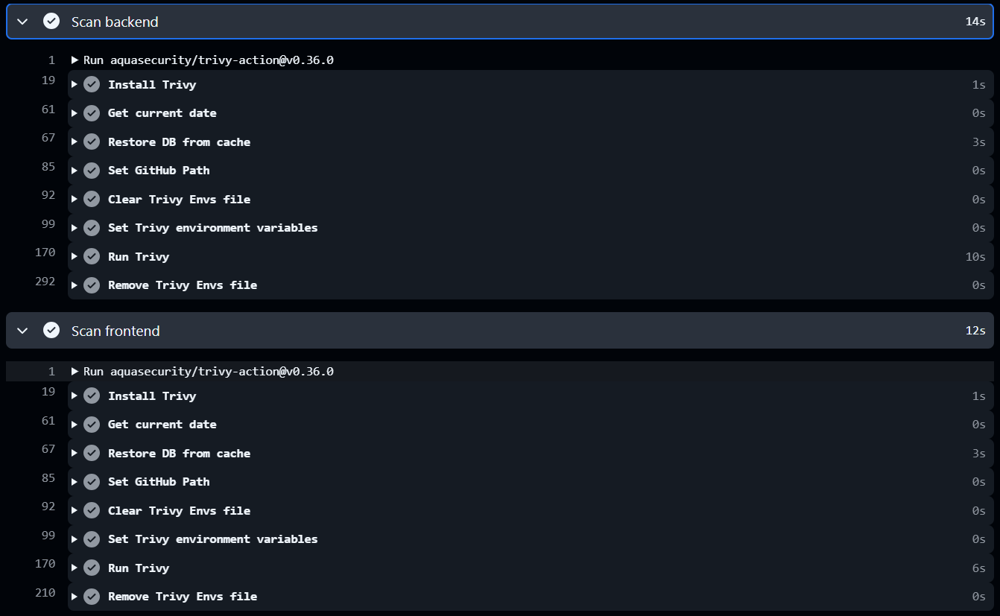

---

## M7 — Terraform (AWS VPC and EKS)

**Files:** `terraform/main.tf`, `variables.tf`, `outputs.tf`, `versions.tf`. Example variables: `terraform/terraform.tfvars.example` (placeholder values only).

**Provisioned resources:**

- VPC `expense-tracker-vpc` with 2 public and 2 private subnets, and one NAT gateway
- EKS cluster `expense-tracker-eks` (Kubernetes 1.31)
- Managed node group `main` with 2 `t3.medium` nodes, scaling from 2 to 4

**Results:** `terraform plan` shows 54 resources to add. `terraform apply` creates the VPC and the EKS cluster. `terraform destroy` removes all resources.

**Screenshots:**

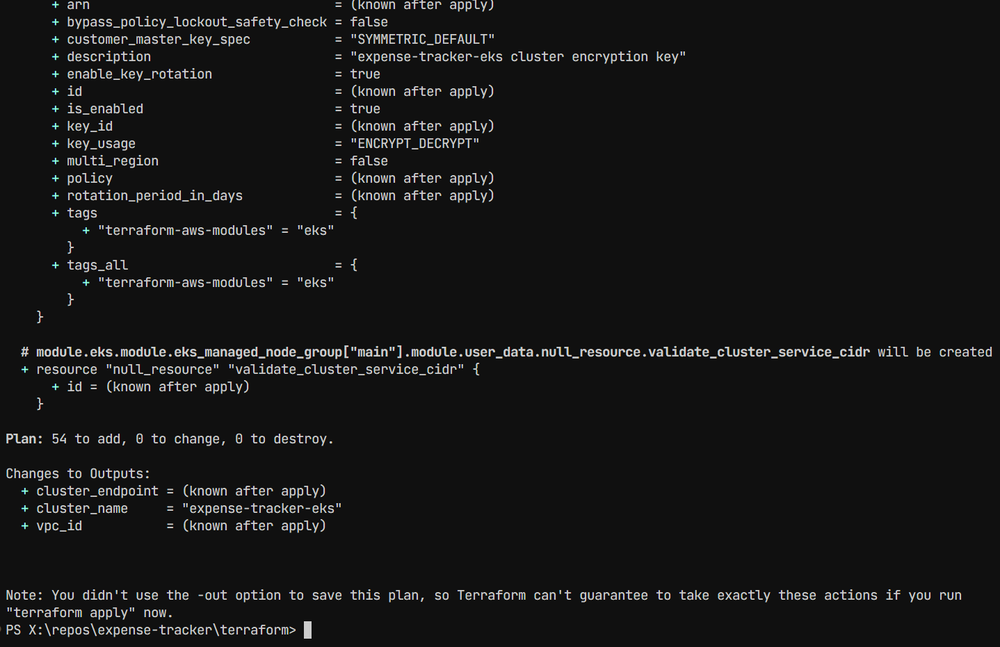

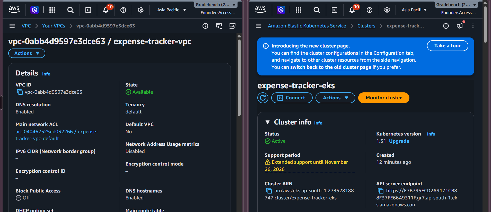

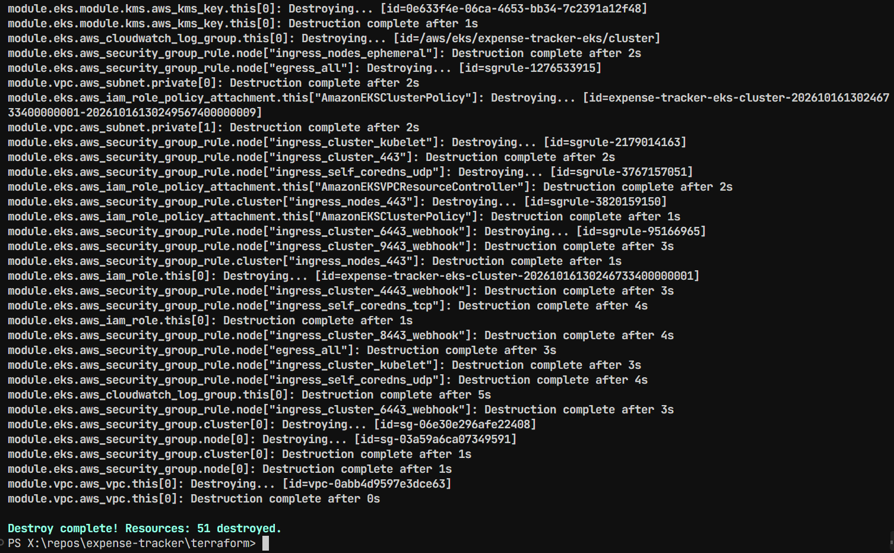

---

## M8 — Kubernetes and Helm

**Files:**

- `k8s/namespace.yaml` (namespace `expense-tracker`)
- `helm/expense-tracker/` (chart with `Chart.yaml`, `values*.yaml`, and templates for the backend, frontend, PostgreSQL, Ingress, HPA, and ServiceMonitor)

**Routing:** The Ingress sends `/api` to the backend Service on port 8000, and `/` to the frontend Service on port 80.

**Environment:** minikube, with the `ingress-nginx` addon. The chart installs with `helm upgrade --install expense-tracker ./helm/expense-tracker -n expense-tracker -f helm/expense-tracker/values-dev.yaml`.

**Screenshots:**

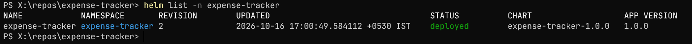

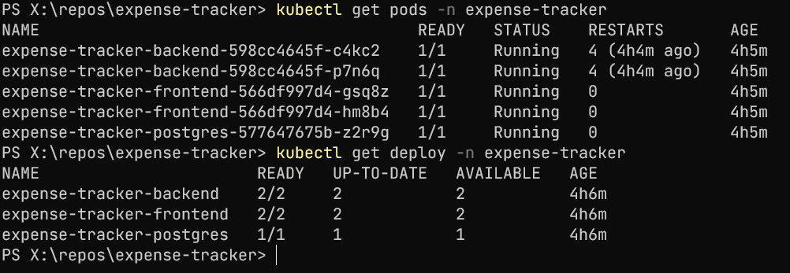

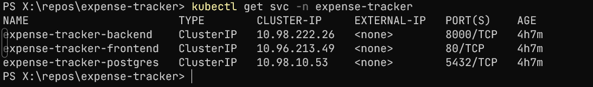

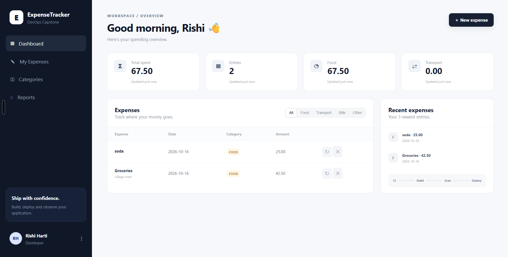

---

## M9 — Observability (Prometheus and Grafana)

**Files:** `monitoring/prometheus-values.yaml`. The backend exposes `/metrics` with the FastAPI Prometheus instrumentator. The Helm chart includes a ServiceMonitor for the backend.

**Setup:** `kube-prometheus-stack` runs in the `monitoring` namespace. Prometheus scrapes both backend pods. The Grafana dashboard `ExpenseTracker HTTP` shows two panels: requests per second, and requests per second by handler.

**Screenshots:**

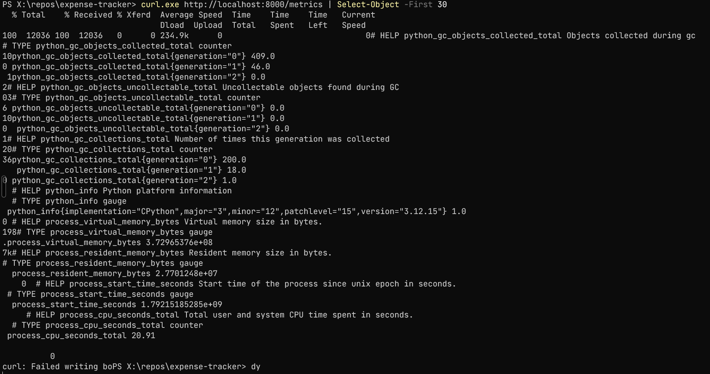

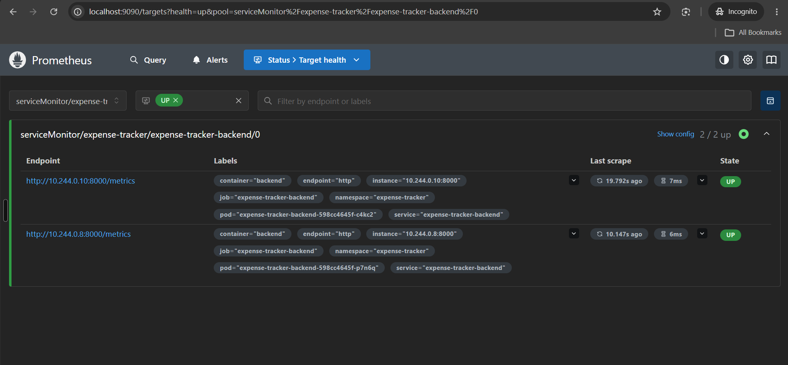

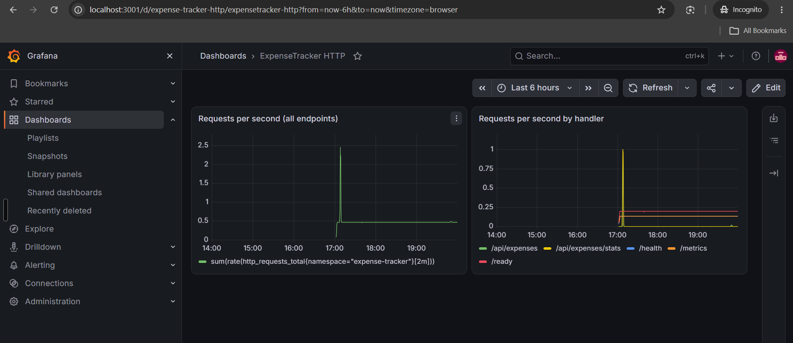

---

## M10 — Documentation, Presentation and Video

**README:** [`README.md`](README.md) is the full technical documentation. It covers the project, architecture, stack, local setup with `docker compose up`, CI/CD, Terraform, Kubernetes and Helm, observability, verified results, and known limitations.

**Slide deck:** [`demo/presentation.pptx`](demo/presentation.pptx), 10 slides.

**Presentation video:** `demo/presentation.mp4`. The video shows the slides first, then a live walkthrough of the code, the CI/CD run, the Terraform plan and AWS console, the Kubernetes resources, the Prometheus targets, and the Grafana dashboard.

**Known gap:** ArgoCD (GitOps) is not set up. Deployment is a manual Helm upgrade, as described in the README.
